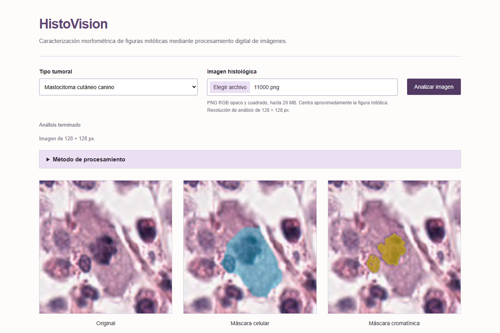
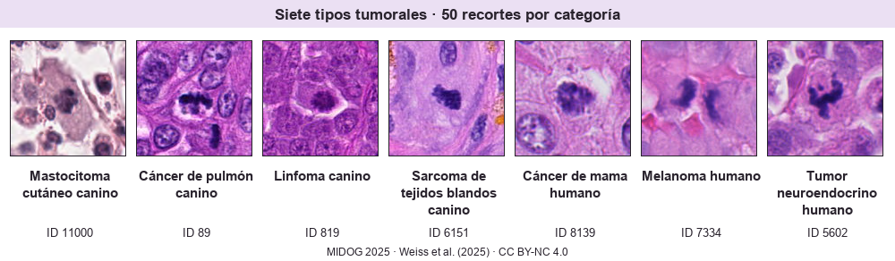
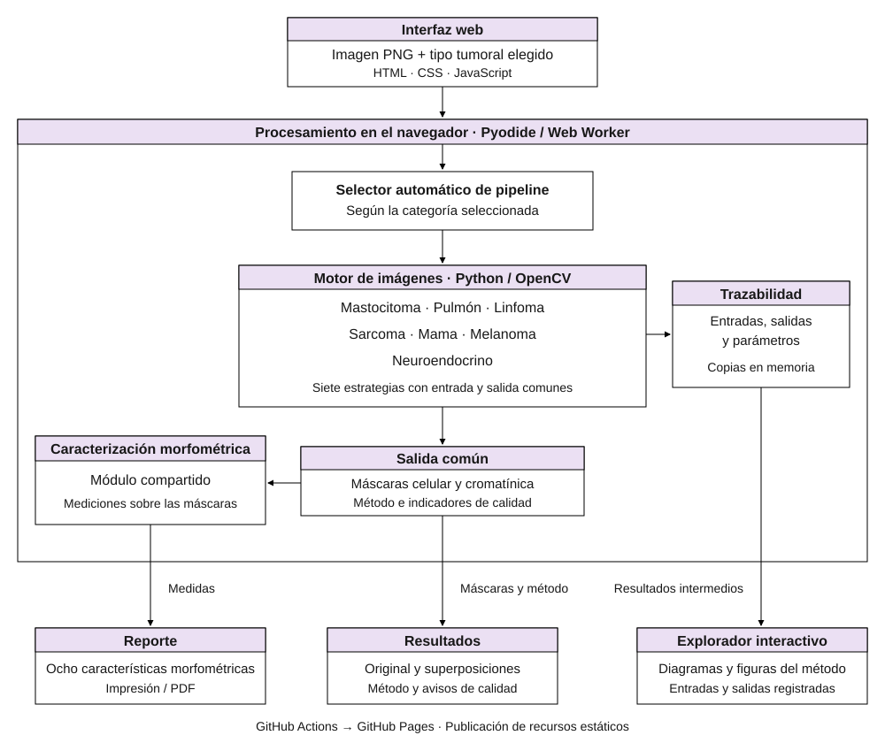
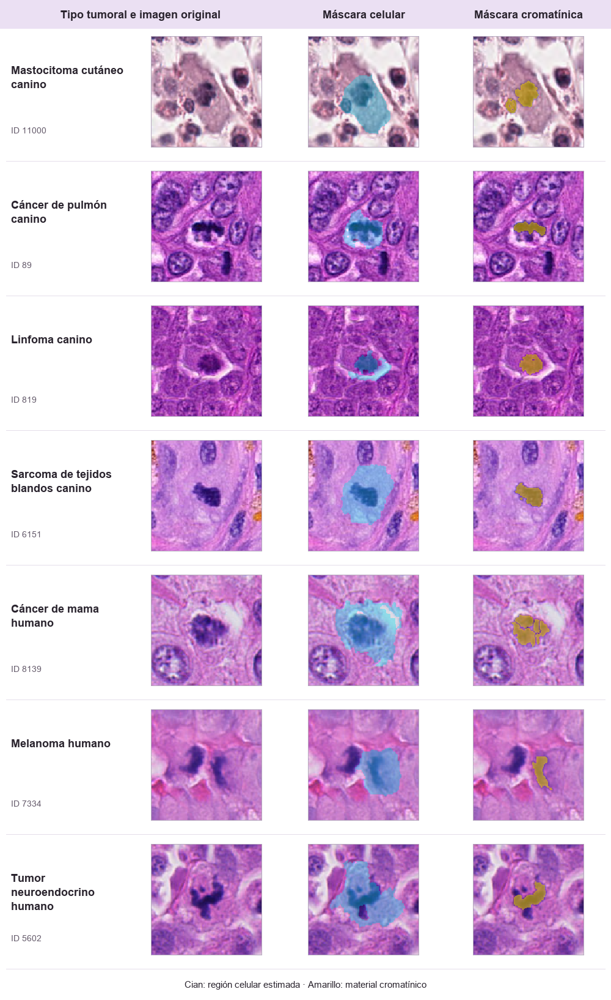
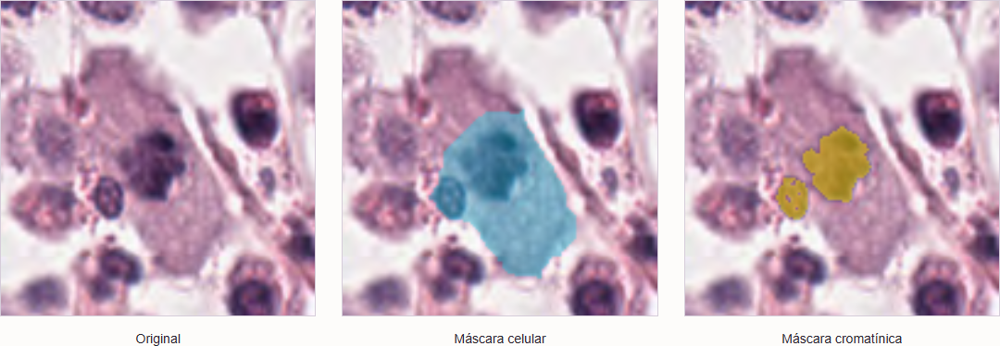
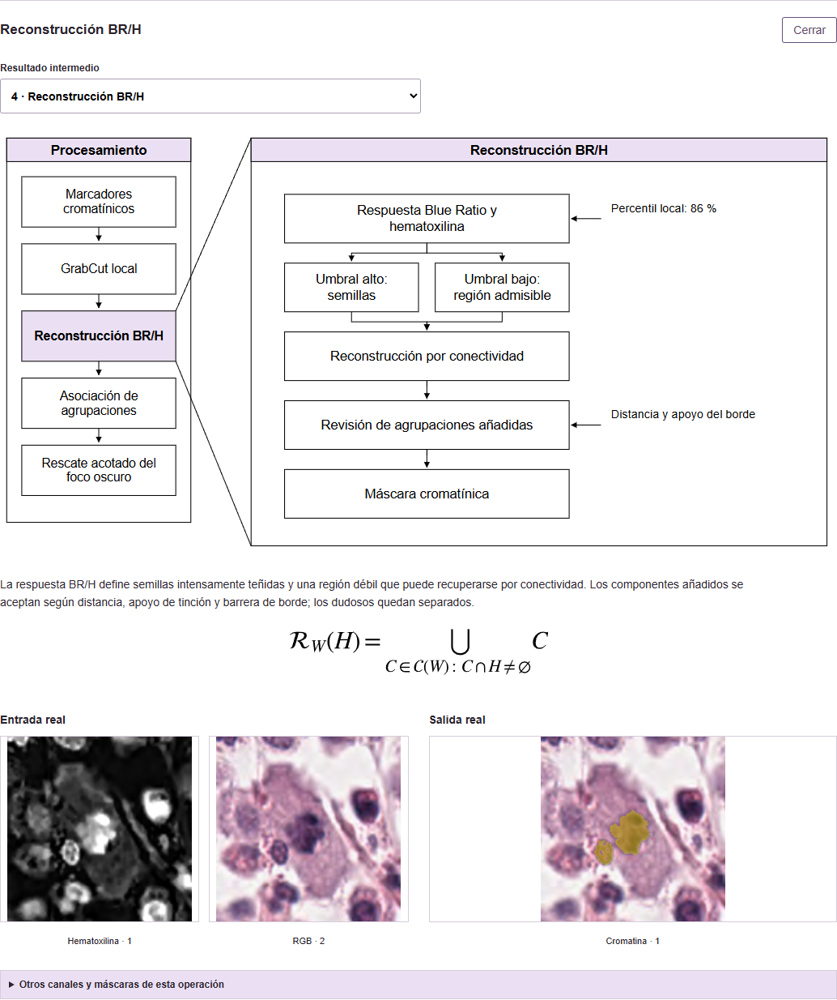
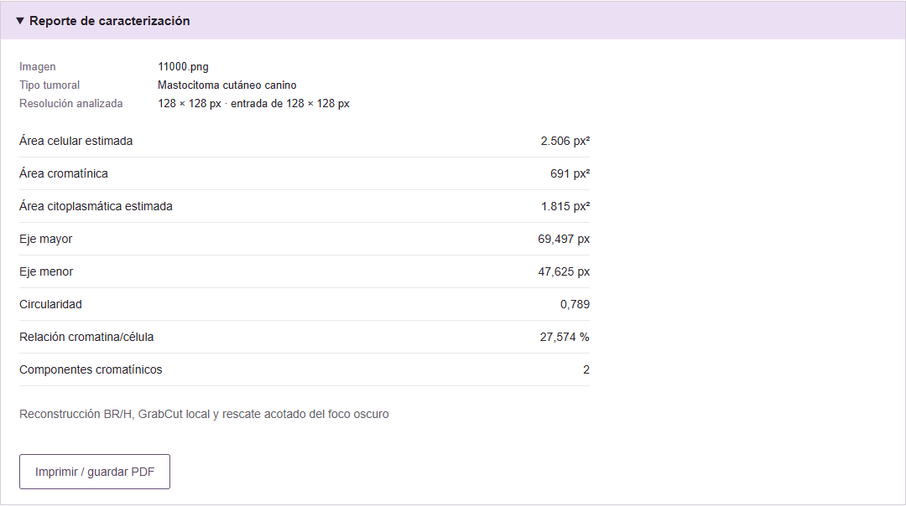

# HistoVision

**[Acceder a HistoVision](https://linafperez.github.io/HistoVision/)**

HistoVision es una aplicación web para la segmentación y caracterización morfométrica de figuras mitóticas en imágenes histológicas teñidas con hematoxilina y eosina (H&E). Sus siete pipelines permiten estimar la región celular, delimitar el material cromatínico y explorar las transformaciones realizadas sobre cada imagen. Utiliza técnicas clásicas de visión artificial con OpenCV, sin requerir el entrenamiento de redes neuronales.



## 1. Base de datos

Las imágenes proceden del **MIDOG 2025 Atypical Training Set**, derivado de MIDOG++. La [versión inicial (v1)](https://doi.org/10.5281/zenodo.15188326) publica **11.939 registros de figuras mitóticas**: 10.191 normales y 1.748 atípicas. Los recortes son PNG de **128 × 128 píxeles**, en tejidos humanos y caninos teñidos con H&E, de distintos centros y escáneres. Estas cifras corresponden a v1; el [CSV corregido de v3](https://doi.org/10.5281/zenodo.16044804) contiene 11.937 identificadores únicos.

El desarrollo experimental empleó **350 imágenes: 50 por cada tipo tumoral**. Sus archivos `metadata.csv` conservan la procedencia y las anotaciones originales; las 350 filas se contrastaron con el CSV oficial de v1. Las etiquetas normal/atípica corresponden a la tarea original de clasificación: HistoVision realiza segmentación y caracterización morfométrica. La variabilidad cromática, morfológica y textural entre tejidos motivó el uso de pipelines diferenciados.



Imágenes de **Weiss et al. (2025)**, [MIDOG 2025, v1](https://doi.org/10.5281/zenodo.15188326), bajo [CC BY-NC 4.0](https://creativecommons.org/licenses/by-nc/4.0/): reutilización con atribución y fines no comerciales. Las figuras y capturas incorporan composiciones y superposiciones generadas por HistoVision.

## 2. Arquitectura del software

La interfaz HTML/CSS/JavaScript envía la imagen y la categoría a un **Web Worker**, donde **Pyodide** ejecuta Python y OpenCV con NumPy, SciPy y scikit-image. El selector activa automáticamente el pipeline de la categoría elegida; las siete rutas comparten entrada RGB y salida de máscaras, indicadores y descripción del método. El servicio coordina el registro de entradas y salidas en memoria y el módulo morfométrico compartido, que opera sobre las máscaras. La interfaz presenta superposiciones, reporte y exploración interactiva sin repetir el análisis por cada clic. **GitHub Actions** empaqueta los recursos estáticos y los publica en **GitHub Pages**.



```text
app/                     Coordinación del análisis y trazabilidad
assets/                  Interfaz, diagramas y figuras metodológicas
pipelines_histologia/    Selector, siete pipelines y control de calidad
caracterizacion/         Morfometría compartida
docs/images/             Figuras y capturas del README
data/                    Subconjunto local y metadatos; no versionado
.github/workflows/       Publicación en GitHub Pages
```

## 3. Pipelines de procesamiento

Cada categoría utiliza una estrategia adaptada al tejido; cuando existen alternativas, el pipeline selecciona sus estimaciones mediante criterios internos de evidencia y consistencia.

| Tipo tumoral | Método principal de procesamiento |
|---|---|
| Mastocitoma cutáneo canino | GrabCut local y reconstrucción cromatínica BR/H, con rescate acotado del foco oscuro. |
| Cáncer de pulmón canino | Competencia regional Multi-Otsu y territorios cromáticos; selección entre propuestas regionales y de apariencia. |
| Linfoma canino | Cuencas multicanal y jerárquicas, asociación por grafos y corte de transición; selección conjunta de máscaras. |
| Sarcoma de tejidos blandos canino | Grafo CIELAB–Gabor con cromatina fija; selección del cuerpo entre estimaciones regionales y de apariencia. |
| Cáncer de mama humano | Reconstrucción Multi-Otsu; selección celular entre reconstrucción, GMM de banda y contorno activo regional. |
| Melanoma humano | Blue Ratio y doble umbralización; revisión del foco dominante y ampliación celular condicional mediante GMM. |
| Tumor neuroendocrino humano | Territorios de tejido y tinción, revisión cromatínica por intensidad/densidad, Random Walker condicional y modelos regionales GMM. |

Ejemplos obtenidos al ejecutar los siete pipelines sobre los mismos recortes de la figura anterior. Cian: región celular estimada; amarillo: cromatina.



## 4. Funcionamiento de la aplicación

Selecciona el tipo tumoral, carga un recorte histológico PNG y pulsa **Analizar imagen**. El sistema ejecuta automáticamente el pipeline correspondiente.

**Segmentación.** Imagen original y superposiciones celular y cromatínica.



**Exploración interactiva.** Una caja seleccionada despliega su figura metodológica y las entradas y salidas reales, recuperadas del registro en memoria.



**Caracterización morfométrica.** El reporte incluye las áreas celular, cromatínica y citoplasmática estimadas, los ejes mayor y menor, la circularidad, la relación cromatina/célula y el número de componentes cromatínicos.



## 5. Ejecución local

```bash
git clone https://github.com/linafperez/HistoVision.git
cd HistoVision
python -m http.server 8000
```

Abrir http://localhost:8000. Se requiere conexión a Internet para cargar el motor de Python y sus dependencias; las imágenes se procesan en el navegador.

## 6. Referencias

- **MIDOG 2025:** [datasets](https://midog2025.deepmicroscopy.org/datasets/) y [Track 2: Atypical Classification](https://midog2025.deepmicroscopy.org/track-2-atypical-classification/).
- **Weiss et al. (2025).** *A dataset of atypical vs normal mitoses classification for MIDOG – 2025*: [v1, DOI 10.5281/zenodo.15188326](https://doi.org/10.5281/zenodo.15188326) y [revisión v3, DOI 10.5281/zenodo.16044804](https://doi.org/10.5281/zenodo.16044804).
- **Aubreville et al. (2023).** *A comprehensive multi-domain dataset for mitotic figure detection* (MIDOG++). [DOI: 10.1038/s41597-023-02327-4](https://doi.org/10.1038/s41597-023-02327-4).
- **OpenCV:** [documentación de la versión 4.10](https://docs.opencv.org/4.10.0/).

> HistoVision es una herramienta académica de procesamiento digital de imágenes; las mediciones celulares son estimaciones obtenidas mediante segmentación computacional y estas demostraciones no constituyen una validación clínica.
